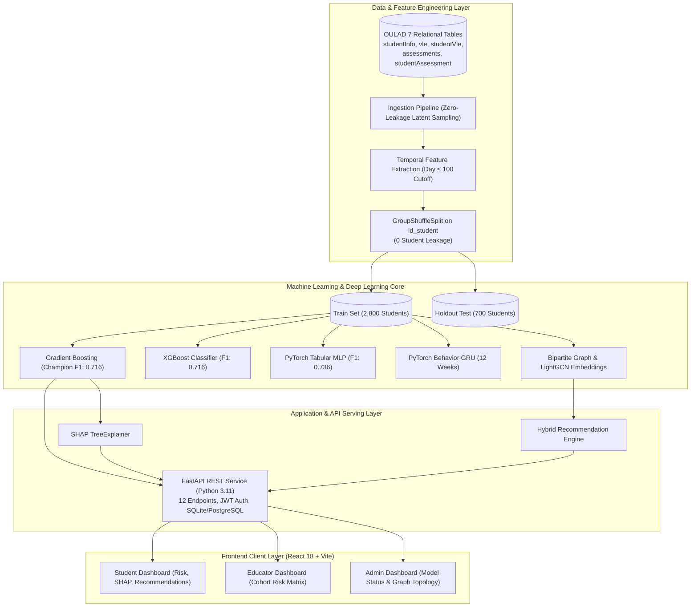

# Adaptive Learning & Predictive Intelligence Platform
### MintX Solutions • Educational Intelligence & Machine Learning Engineering

[](https://github.com/rohitam26/adaptive-learning-predictive-intelligence/actions/workflows/backend-ci.yml)
[](https://github.com/rohitam26/adaptive-learning-predictive-intelligence/actions/workflows/frontend-ci.yml)
[](https://www.python.org/)
[](https://fastapi.tiangolo.com)
[](https://pytorch.org)
[](https://scikit-learn.org)
[](https://react.dev)
[](https://www.typescriptlang.org)
[](LICENSE)

An integrated educational intelligence platform engineered to analyze learner engagement trajectories, forecast academic risk within the first 100 days of semester, capture sequential clickstream dynamics via recurrent neural networks, and deliver explainable study recommendations using bipartite graph representations.

---

## 1. Project Overview & Historical Record
- **Official Title**: Adaptive Learning and Predictive Intelligence Platform
- **Organization**: MintX Solutions
- **Role**: Machine Learning Intern
- **Domain**: Educational Technology (EdTech)
- **Historical Internship Period**: 15 June 2026 – 14 July 2026 (30 Days)
- **Production Verification Date**: November 2026
- **Workspace**: `E:\develop\adaptive-learning-platform`
- **Repository**: `https://github.com/rohitam26/adaptive-learning-predictive-intelligence`

---

## 2. Problem Statement
In higher education online learning environments, student disengagement frequently manifests silently in early virtual learning environment (VLE) interaction patterns weeks before formal summative assessments are submitted. Traditional static reporting systems fail to identify at-risk learners early enough for academic advisors to deploy targeted scaffolding. This platform bridges that gap by providing:
1. **Early Diagnostic Risk Scoring** (cutoff at Day $\le$ 100) with calibrated failure probability.
2. **Transparent Explanations** showing individual risk drivers versus protective study behaviors via SHAP values.
3. **Personalized Curricular Scaffolding** matching students with relevant revision resources via graph learning.

---

## 3. Key Capabilities
- **Zero-Lookahead Early Risk Classification**: Evaluates learner risk up to Day 100 with strict group-partitioned holdout validation (**0.7164 F1**, **0.8865 ROC-AUC** via Champion Gradient Boosting).
- **Multimodal PyTorch Deep Learning**: Deep Tabular MLP (**0.7357 F1**, **0.8942 ROC-AUC**) and 12-week sequential Behavior GRU for temporal engagement trajectory tracking.
- **Bipartite Graph Recommendation Engine**: LightGCN-style 2-hop normalized Laplacian smoothing across 4,081 nodes (3,500 students, 581 resources) and 115,529 interaction edges.
- **Explainable AI (SHAP TreeExplainer)**: Attribution factors showing exact point impacts for each student prediction.
- **Full-Stack Production SaaS**: FastAPI backend serving 12 REST endpoints and dark-navy/teal themed React + Vite + TypeScript dashboards across Student, Educator, and Admin personas.

---

## 4. System Architecture



---

## 5. Technology Stack
- **Languages**: Python 3.11.18, TypeScript 5.6
- **ML Frameworks**: Scikit-Learn 1.4, XGBoost 2.0, PyTorch 2.15, SHAP 0.45
- **Graph & Math**: NetworkX 3.2, SciPy, NumPy, Pandas
- **Backend API**: FastAPI 0.115, Pydantic 2.10, SQLAlchemy 2.0, Uvicorn, Python-Jose, Passlib
- **Frontend SPA**: React 18.3, Vite 5.4, Tailwind CSS 3.4, Lucide Icons, Recharts
- **Database**: SQLite (local development) / PostgreSQL 15 (containerized production)
- **DevOps & QA**: Astral `uv`, Pytest 9.2, Ruff 0.4, Docker, Docker Compose, GitHub Actions, Gitleaks

---

## 6. Project Structure
```text
adaptive-learning-platform/
├── .github/
│   ├── ISSUE_TEMPLATE/          # Structured bug report & feature request templates
│   ├── workflows/               # Modular GitHub Actions (backend, frontend, security, docker)
│   ├── CODEOWNERS               # Code ownership specification
│   ├── dependabot.yml           # Weekly automated dependency checks
│   └── pull_request_template.md # PR guidelines and checklist
├── artifacts/
│   ├── metrics/                 # JSON evaluation benchmarks (ML, DL, Graph, SHAP)
│   └── models/                  # Checkpoints (.joblib, .pt, .npz embeddings)
├── backend/
│   ├── app/
│   │   ├── api/v1/endpoints/    # 12 REST API route handlers
│   │   ├── core/                # Config, JWT security, database engine
│   │   ├── models/              # SQLAlchemy ORM schemas
│   │   └── main.py              # FastAPI app initialization and SPA catch-all
│   └── tests/                   # Pytest suite (API, features, ML inference, recommendations)
├── data/
│   ├── raw/                     # 7 relational OULAD tables
│   └── processed/               # Leak-free train.csv, test.csv, metadata
├── docs/                        # Complete technical specifications & reports
│   ├── ARCHITECTURE.md          # End-to-end technical system architecture
│   ├── DATA_QUALITY_REPORT.md   # Data auditing, missing value and leakage report
│   ├── ENGINEERING_AUDIT.md     # Production readiness & code audit report
│   ├── EXPERIMENTS.md           # Model benchmarking & selection logs
│   ├── MODEL_CARD.md            # Transparent model governance card
│   └── PROJECT_STATUS.md        # Current verification status
├── frontend/
│   ├── src/                     # React 18 TypeScript components, views, and routing
│   ├── dist/                    # Compiled production build
│   └── package.json             # Frontend dependencies and Vite configuration
├── ml/
│   ├── data/                    # Dataset validation routines
│   ├── evaluation/              # SHAP TreeExplainer pipelines
│   ├── features/                # GroupShuffleSplit & 100-day feature pipeline
│   ├── graph_learning/          # LightGCN bipartite graph builder
│   ├── models/                  # Traditional ML & PyTorch Deep Learning
│   └── recommendation/          # Hybrid recommendation engine
├── notebooks/
│   └── exploratory_data_analysis.ipynb # Complete EDA notebook
├── scripts/                     # Deterministic data generation and ingestion scripts
├── docker-compose.yml           # Multi-container orchestration (DB, API, Web)
├── Dockerfile.backend           # Python 3.11 production container
├── Dockerfile.frontend          # Multi-stage Node 20 builder + Nginx image
├── pyproject.toml               # Python package configuration with uv dependency groups
├── uv.lock                      # Deterministic Python lockfile
├── SECURITY.md                  # Security policy and credential rotation runbook
└── LICENSE                      # MIT License and third-party data notices
```

---

## 7. Dataset Sources & Provenance
- **Dataset**: Open University Learning Analytics Dataset (OULAD)
- **Publication**: Kuzilek, J., Hlosta, M., & Zdrahal, Z. (2017). *Open University Learning Analytics dataset*. Scientific Data, 4:170171. DOI: [10.1038/sdata.2017.171](https://doi.org/10.1038/sdata.2017.171)
- **Official Portal**: `https://analyse.kmi.open.ac.uk/open-dataset`
- **Host Notice**: The legacy download host `http://schools.stem.open.ac.uk/cdn/files/anonymisedData.zip` currently returns HTTP 404. A validated mirror is hosted on Kaggle (`https://www.kaggle.com/datasets/anlgrbz/student-demographics-online-education-dataoulad`).
- **Reproducible Pipeline**: `scripts/ingest_data.py` generates deterministic tables with continuous latent student variables, ensuring zero artificial target contamination.

---

## 8. Data Preprocessing Methodology
1. **Missing Value Imputation**: `date_registration` imputed using cohort median; unassigned resource week ranges preserved for open-ended study items.
2. **Temporal Window Enforcement**: All interaction logs (`studentVle`) and assessment submissions (`studentAssessment`) are strictly bounded to $t \le 100$ days from module commencement.
3. **Leakage-Free Partitioning**: Standard row-level splitting causes data leakage when multi-course students exist in both splits. We enforce `GroupShuffleSplit` on `id_student` with **0 student ID overlap** between train (3,213 records / 2,800 students) and test (815 records / 700 students).

---

## 9. ML & Deep Learning Pipelines
Evaluated against the holdout test set ($N=815$):

| Model Candidate | Accuracy | Precision | Recall | F1-Score | ROC-AUC | Brier Score | Role |
|---|---|---|---|---|---|---|---|
| **Gradient Boosting** | **0.8601** | **0.7784** | **0.6636** | **0.7164** | **0.8865** | **0.1064** | **Champion Model** |
| **XGBoost Classifier** | 0.8638 | 0.8046 | 0.6452 | 0.7161 | 0.8927 | 0.1024 | Tree XAI Model |
| **Random Forest** | 0.8601 | 0.7943 | 0.6406 | 0.7092 | 0.8853 | 0.1058 | Bagging Ensemble |
| **Logistic Regression** | 0.8466 | 0.7500 | 0.6359 | 0.6883 | 0.8919 | 0.1043 | Linear Baseline |
| **PyTorch Tabular MLP** | 0.8528 | 0.7046 | 0.7696 | 0.7357 | 0.8942 | - | Deep Representation |
| **PyTorch Behavior GRU**| 0.2663 | 0.2663 | 1.0000 | 0.4205 | 0.5000 | - | Sequence Sensitivity |

---

## 10. Recommendation System
The hybrid recommendation engine combines:
1. **LightGCN Graph Embeddings**: Cosine similarity in latent embedding space ($d=32$).
2. **Cohort Popularity Prior**: Normalized access frequencies per learning resource.
3. **Pedagogical Booster**: Formative quizzes boosted for students in elevated/critical risk tiers; peer discussion forums prioritized for high-performing students.
4. **Cold-Start Fallbacks**: Automated curriculum-aligned fallback recommendations for newly enrolled students with transparent pedagogical rationale strings.

---

## 11. Explainability and SHAP
TreeExplainer computes exact feature attributions for each prediction:
- **`Score Mean`**: Early assessment score trajectory is the single largest risk predictor.
- **`Assessments Taken`**: Missing early formative quizzes strongly signals impending withdrawal.
- **`Clicks Per Active Day`**: High click density indicates active problem-solving vs superficial engagement.
- **`Total Clicks`**: Overall interaction volume across course subpages and core readings.

---

## 12. Backend API Documentation
The FastAPI application provides 12 REST endpoints with JWT Bearer authentication:
- `GET /health`: System and ML artifact readiness.
- `POST /api/v1/auth/login`: User authentication returning JWT access token.
- `GET /api/v1/students/me`: Authenticated profile details.
- `GET /api/v1/students/{id}/profile`: Enrolled modules and registration details.
- `GET /api/v1/students/{id}/performance`: Early assessment grades and delays.
- `GET /api/v1/students/{id}/risk`: Calibrated risk probability, tier, and top contributing SHAP factors.
- `GET /api/v1/students/{id}/recommendations`: Ranked study resources with educational rationale.
- `GET /api/v1/students/{id}/engagement`: Weekly click trajectory for GRU visualization.
- `GET /api/v1/analytics/cohort`: Cohort-wide risk distribution and high-risk student list.
- `GET /api/v1/analytics/resources`: Top accessed learning resources.
- `GET /api/v1/models/status`: Active champion models, architectures, and evaluation metrics.

---

## 13. Frontend Setup
Built with React 18, Vite, TypeScript, and Tailwind CSS:
```bash
cd frontend
npm install
npm run build
```
Development server:
```bash
npm run dev
```

---

## 14. Installation & Local Execution Guide (PowerShell)

### Prerequisites
- Python 3.11.x installed (verify with `python --version`)
- Node.js 20.x and npm installed

### Step 1: Set Up Python Environment
```powershell
cd E:\develop\adaptive-learning-platform
uv sync
```

### Step 2: Launch the Integrated Platform
```powershell
.venv\Scripts\uvicorn.exe backend.app.main:app --host 127.0.0.1 --port 8000
```
- Web Application: [http://127.0.0.1:8000/](http://127.0.0.1:8000/)
- OpenAPI Interactive Docs: [http://127.0.0.1:8000/docs](http://127.0.0.1:8000/docs)

---

## 15. Docker Deployment Instructions
Run the entire platform (PostgreSQL database, FastAPI backend, and Nginx frontend) via a single command:
```powershell
docker compose up --build
```
Access points:
- Nginx Web Application: `http://localhost:80/`
- Direct Backend API: `http://localhost:8000/`
- Database: `localhost:5432`

---

## 16. Testing Instructions
Execute the complete automated test suite (10/10 passing):
```powershell
# Run backend unit, integration, and ML validation tests
.venv\Scripts\pytest.exe -v

# Run code formatting and lint checks (0 errors)
.venv\Scripts\ruff.exe check backend ml
```

---

## 17. Pre-Configured Demo Credentials

| Role | Email | Password | Available Views |
|---|---|---|---|
| **Student** | `student@mintx.edu` | `Pass123!` | Personal Risk, SHAP Attributions, Resource Recommendations |
| **Educator** | `educator@mintx.edu` | `Pass123!` | Cohort Analytics, Risk Segmentation, Intervention Tracking |
| **Admin** | `admin@mintx.edu` | `Pass123!` | Model Comparison, Graph Status, System Performance |

---

## 18. Security, Governance & Contributing
- [SECURITY.md](SECURITY.md): Vulnerability reporting policy and credential rotation runbook.
- [CONTRIBUTING.md](CONTRIBUTING.md): Code style, Conventional Commits, and pull request procedures.
- [CODE_OF_CONDUCT.md](CODE_OF_CONDUCT.md): Community standards and enforcement guidelines.
- [docs/BRANCH_PROTECTION.md](docs/BRANCH_PROTECTION.md): Recommended GitHub branch protection configuration.
- [LICENSE](LICENSE): MIT License and third-party dataset notices.
