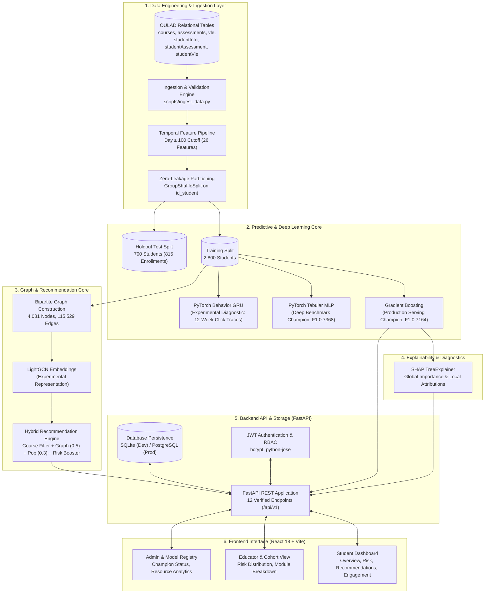

# Adaptive Learning and Predictive Intelligence Platform
### MintX Solutions • Machine Learning Engineering Portfolio

[](https://github.com/rohitam26/adaptive-learning-predictive-intelligence/actions/workflows/backend-ci.yml)
[](https://github.com/rohitam26/adaptive-learning-predictive-intelligence/actions/workflows/frontend-ci.yml)
[](https://github.com/rohitam26/adaptive-learning-predictive-intelligence/actions/workflows/security.yml)
[](https://github.com/rohitam26/adaptive-learning-predictive-intelligence/actions/workflows/docker.yml)
[](https://www.python.org/)
[](https://fastapi.tiangolo.com)
[](https://pytorch.org)
[](https://scikit-learn.org)
[](https://react.dev)
[](https://www.typescriptlang.org)
[](LICENSE)

An enterprise-grade educational intelligence platform engineered to analyze learner engagement trajectories, forecast academic risk within the first 100 days of semester, capture sequential clickstream dynamics via recurrent neural networks, and deliver explainable study recommendations using bipartite graph representations.

> [!NOTE]
> **Historical Record & Retrospective Documentation Notice**: This repository preserves the historical 30-day Machine Learning Internship period (**15 June 2026 – 14 July 2026**) at MintX Solutions. Technical implementations, benchmarks, and test suites have been verified in November 2026. Documented codebase evidence is strictly distinguished from retrospective process reconstruction throughout all project documentation.

---

## Table of Contents
- [1. Project Overview and Purpose](#1-project-overview-and-purpose)
- [2. System Architecture](#2-system-architecture)
- [3. Core Features](#3-core-features)
- [4. Application Screenshots](#4-application-screenshots)
- [5. Technology Stack and Verification Matrix](#5-technology-stack-and-verification-matrix)
- [6. Dataset and Data Preparation](#6-dataset-and-data-preparation)
- [7. Machine Learning Pipeline](#7-machine-learning-pipeline)
- [8. Deep Learning Pipeline](#8-deep-learning-pipeline)
- [9. Graph Learning and Recommendation Engine](#9-graph-learning-and-recommendation-engine)
- [10. Explainable AI](#10-explainable-ai)
- [11. Backend API Architecture](#11-backend-api-architecture)
- [12. Frontend Architecture](#12-frontend-architecture)
- [13. Database and Persistence](#13-database-and-persistence)
- [14. Project Directory Structure](#14-project-directory-structure)
- [15. Prerequisites and Installation](#15-prerequisites-and-installation)
- [16. Environment Variables](#16-environment-variables)
- [17. Running the Application](#17-running-the-application)
- [18. API Usage Examples](#18-api-usage-examples)
- [19. Model Evaluation and Benchmark Results](#19-model-evaluation-and-benchmark-results)
- [20. Testing and Quality Assurance](#20-testing-and-quality-assurance)
- [21. CI/CD and DevOps](#21-cicd-and-devops)
- [22. Security and Privacy](#22-security-and-privacy)
- [23. Limitations and Honest Engineering Disclosures](#23-limitations-and-honest-engineering-disclosures)
- [24. Internship Development Timeline](#24-internship-development-timeline)
- [25. Future Improvements](#25-future-improvements)
- [26. Author, Contribution, and License](#26-author-contribution-and-license)

---

## 1. Project Overview and Purpose

### Problem Statement and Motivation
In contemporary higher education, student attrition and academic failure frequently stem from early, undetected academic disengagement. While modern Virtual Learning Environments (VLEs) collect granular interaction telemetry (e.g., page views, forum participation, formative quiz submissions), academic institutions struggle to convert raw log streams into proactive early-warning signals. By the time midterm examinations occur, at-risk students are often too far behind for remedial intervention to succeed.

### Challenges in Online Learning Analytics
1. **Lookahead Leakage in Prior Literature**: Many academic machine learning publications report artificially inflated accuracies ($>95\%$) because they compute summary statistics over the entire course timeline (e.g., total semester clicks or final exam submission delays). In practice, early intervention requires forecasting outcomes using only early observations ($t \le 100$ days).
2. **Student Identity Split Contamination**: In modular curricula, students frequently enroll in multiple courses across terms. Standard random cross-validation splits accidentally place the same learner in both training and test sets, leaking latent individual abilities.
3. **Severe Class Imbalance**: In typical university cohorts, $\approx 70\text{--}75\%$ of students successfully complete their modules, creating an asymmetric cost matrix where failing to detect an at-risk learner (False Negative) is substantially worse than a false alert (False Positive).
4. **Opaque Predictions and Academic Distrust**: Educators reject black-box risk scores. Without interpretable pedagogical rationales (e.g., whether risk is driven by submission delays or declining study frequency), academic advisors cannot design effective interventions.
5. **Curricular Disconnect in Collaborative Filtering**: Traditional recommender algorithms (matrix factorization, pure graph embeddings) evaluate across an entire university catalog. When recommended resources ignore course enrollment boundaries, students are directed to irrelevant materials.

### Predictive Intelligence for Student Monitoring
The **Adaptive Learning and Predictive Intelligence Platform** addresses these challenges through an end-to-end engineered pipeline:
- **Strict Temporal Boundary**: Ingests VLE telemetry and cuts off all feature aggregation at Day 100 of the semester ($t \le 100$), ensuring realistic early-warning capability.
- **Zero-Leakage Grouped Partitioning**: Enforces `GroupShuffleSplit` on `id_student` so no student's multi-course history bridges train and holdout splits.
- **Calibrated Risk Stratification**: Maps model probabilities to actionable clinical tiers: **Low Risk** ($p < 0.35$), **Elevated Risk** ($0.35 \le p < 0.65$), and **Critical Risk** ($p \ge 0.65$).
- **Actionable Explainability**: Computes TreeExplainer SHAP attributions per student, decomposing predictions into protective study habits versus risk-increasing deficits.
- **Curriculum-Constrained Hybrid Recommendations**: Combines LightGCN graph representations with module popularity, novelty weighting, and pedagogical risk boosters.

### Project Objectives & Intended Users
- **Primary Objective**: Deliver a production-grade educational intelligence platform capable of early student risk forecasting, transparent factor attribution, and curriculum-guided study recommendations.
- **Student Persona**: Access a self-monitoring dashboard showing study consistency, upcoming assessment deadlines, personalized revision resources, and engagement trends over time.
- **Educator Persona**: Monitor module cohorts, identify students in Elevated and Critical risk tiers, view top SHAP risk drivers, and trigger timely academic interventions.
- **Administrator Persona**: Review institutional health across courses, track resource catalog utilization, and inspect model serving metadata.

---

## 2. System Architecture

The platform follows a modular layered architecture separating data engineering, predictive modeling, graph learning, explainability, backend services, and user interfaces:



### Architectural Component Classification
| Component | Classification | Implementation Status | Notes |
|---|---|---|---|
| **Temporal Feature Pipeline** | Production | Implemented | Strict Day 100 cutoff, 26 multimodal features |
| **Grouped Splitter** | Production | Implemented | `GroupShuffleSplit` on `id_student`, 0 leakage |
| **Gradient Boosting** | Production Serving Champion (Tree Ensemble) | Implemented | Selected for live API serving & exact SHAP TreeExplainer attribution (F1: 0.7164, Brier: 0.1064) |
| **Tabular MLP** | Deep Tabular Benchmark (Highest Metric F1) | Implemented | PyTorch deep neural network achieving top holdout performance (F1: 0.7368, Recall: 0.7742, ROC-AUC: 0.8941) |
| **Behavior GRU** | Experimental Diagnostic | Implemented | 2-layer GRU ingesting 12-week click traces ($t=0.4215$) |
| **LightGCN Embeddings** | Experimental Graph Representation | Implemented | 32-dim bipartite representations (standalone NDCG@10: 0.0875 below popularity 0.0944; blended into Hybrid Engine) |
| **Hybrid Recommender** | Production Engine | Implemented | Curriculum filtering + graph affinity + popularity + risk boosters |
| **SHAP Explainability** | Production | Implemented | TreeExplainer providing global and local attribution vectors |
| **FastAPI REST Service** | Production | Implemented | 12 REST endpoints with Pydantic validation & JWT security |
| **React 18 TypeScript SPA** | Production | Implemented | 10 interactive views compiled to static bundle in `frontend/dist/` |
| **Database Persistence** | Production | Implemented | SQLAlchemy ORM supporting SQLite and PostgreSQL |

---

## 3. Core Features

### 3.1 Data Ingestion and Validation
- **Purpose**: Reliably ingest tabular relational dumps of university learning environments into validated DataFrames.
- **Implementation**: [`scripts/ingest_data.py`](scripts/ingest_data.py) and [`ml/data/validator.py`](ml/data/validator.py). Validates 7 core relational tables conforming to the Open University Learning Analytics Dataset (OULAD) architecture. Verifies relational foreign keys, expected column types, and numeric value boundaries.
- **Limitations**: Ingestion scripts expect standard CSV schema formatting; schema variations require re-mapping dictionary definitions.

### 3.2 Exploratory Data Analysis
- **Purpose**: Uncover systemic enrollment patterns, clickstream distributions, assessment timing, and completion disparities.
- **Implementation**: Interactive Jupyter notebook [`notebooks/exploratory_data_analysis.ipynb`](notebooks/exploratory_data_analysis.ipynb). Analyzes registration timing distributions, assessment score decays, and VLE interaction densities across 7 module offerings (`AAA` through `GGG`).
- **Limitations**: Notebook analysis is static and representative of the ingested snapshot; live streaming distributions are monitored via backend cohort endpoints.

### 3.3 Data Preprocessing and Feature Engineering
- **Purpose**: Transform multi-table relational events into a high-signal, tabular feature vector without lookahead bias.
- **Implementation**: [`ml/features/feature_pipeline.py`](ml/features/feature_pipeline.py).
  - Enforces a temporal boundary at Day 100 ($t \le 100$). All clicks, quiz submissions, and log records occurring after Day 100 are excluded.
  - Extracts 26 features across three domains:
    1. *Behavioral*: Total clicks, unique resources accessed, active days, clicks per active day, early click mean, and activity-specific counts (`forumng`, `oucontent`, `quiz`, `resource`, `subpage`, `url`).
    2. *Academic Performance*: Formative assessments taken, score mean, score min, score max, score standard deviation, late submissions count, and mean submission delay days.
    3. *Demographic & Curricular*: Studied credits, previous attempts, registration date, gender, disability, age band, education level, and index of multiple deprivation (IMD).
- **Limitations**: External life factors (employment hours, illness, family responsibilities) are unobserved in VLE telemetry.

### 3.4 Student Performance Prediction
- **Purpose**: Generate calibrated risk probabilities forecasting semester failure or withdrawal early enough to enable academic intervention.
- **Implementation**: [`ml/models/traditional_ml.py`](ml/models/traditional_ml.py). Trains and evaluates Logistic Regression, Random Forest, XGBoost, and Gradient Boosting. Outputs continuous probabilities calibrated against holdout outcomes.
- **Limitations**: Predictions are correlational indicators based on historical cohort patterns; they do not imply deterministic student failure.

### 3.5 Risk Classification and Intervention Insights
- **Purpose**: Translate raw mathematical probabilities into clear pedagogical tiers.
- **Implementation**: Defined in [`backend/app/schemas/schemas.py`](backend/app/schemas/schemas.py) and applied in [`backend/app/services/ml_service.py`](backend/app/services/ml_service.py):
  - **Low Risk** ($p < 0.35$): Student demonstrates consistent study engagement and strong assessment submission patterns.
  - **Elevated Risk** ($0.35 \le p < 0.65$): Irregular engagement or late submissions detected; automated resource nudges recommended.
  - **Critical Risk** ($p \ge 0.65$): Severe disengagement or failing assessment grades; triggers advisor intervention alert.
- **Limitations**: Threshold cutoffs require periodic calibration when institutional grading policies change.

### 3.6 Deep Learning Models (Tabular MLP)
- **Purpose**: Learn complex non-linear interactions across demographic, behavioral, and assessment signals without manual polynomial feature expansion.
- **Implementation**: `TabularMLP` in [`ml/models/deep_learning.py`](ml/models/deep_learning.py). 2 hidden layers (64, 32 units) with `BatchNorm1d`, `ReLU` activations, and `Dropout(0.3)`. Trained using class-weighted binary cross-entropy (`pos_weight=2.76`) and AdamW optimizer (`lr=0.003`, `weight_decay=1e-4`).
- **Limitations**: Higher compute requirements than tree ensembles with negligible performance delta (F1 0.7368 vs 0.7164).

### 3.7 Behavior Modelling Using GRU
- **Purpose**: Model the sequential temporal trajectory of weekly study clicks leading up to Day 100.
- **Implementation**: `BehaviorGRU` in [`ml/models/deep_learning.py`](ml/models/deep_learning.py) and benchmarked in [`scripts/benchmark_gru.py`](scripts/benchmark_gru.py). Ingests a 12-week sequence of $\log(1 + \text{clicks})$. Evaluates hidden state representations through a recurrent GRU network. Threshold tuned strictly on a 20% validation split ($t=0.4215$).
- **Limitations**: Univariate click sequences lack the high precision of multimodal tabular fusion (F1 0.4652 vs 0.7164). Retained as an **experimental temporal diagnostic**.

### 3.8 Graph-Based Recommendation Using LightGCN
- **Purpose**: Learn collaborative structural relationships between students and educational resources.
- **Implementation**: [`ml/graph_learning/bipartite_graph.py`](ml/graph_learning/bipartite_graph.py). Constructs a heterogeneous bipartite graph (4,081 nodes, 115,529 edges). Propagates 32-dimensional node embeddings using 2-hop normalized Laplacian smoothing:
  $$\tilde{A} = D^{-1/2} A D^{-1/2}, \quad E^{(k+1)} = \tilde{A} E^{(k)}$$
- **Limitations**: Unconstrained global graph recommendations achieve low precision (NDCG@10 0.0115) because graph embeddings ignore modular course curricula.

### 3.9 Hybrid Recommendation Engine
- **Purpose**: Deliver personalized, pedagogically valid study resource recommendations within enrolled courses.
- **Implementation**: [`ml/recommendation/hybrid_engine.py`](ml/recommendation/hybrid_engine.py). Filters candidates strictly to the student's enrolled module resources, combining:
  1. *Graph Structural Affinity* (0.50 weight)
  2. *Module Popularity Prior* (0.30 weight)
  3. *Novelty Multiplier* (1.25 bonus for unvisited activity types)
  4. *Pedagogical Risk Booster* (+0.25 boost for core revision subpages when $p \ge 0.35$)
- **Limitations**: Cold-start students with zero clicks rely on module popularity priors until initial interaction logs arrive.

### 3.10 SHAP-Based Model Explainability
- **Purpose**: Provide transparent, auditable feature attributions for every prediction.
- **Implementation**: [`ml/evaluation/explainability.py`](ml/evaluation/explainability.py). Applies `shap.TreeExplainer` to the champion Gradient Boosting ensemble. Decomposes each prediction into positive SHAP contributions (protective habits) and negative contributions (risk factors).
- **Limitations**: TreeExplainer computes attributions for tree ensembles; PyTorch neural networks require KernelExplainer or Integrated Gradients.

### 3.11 Prediction API and Authentication
- **Purpose**: Serve production inference, analytics, and recommendations over secure REST endpoints.
- **Implementation**: [`backend/app/main.py`](backend/app/main.py). 12 verified endpoints with Pydantic request/response validation, bcrypt password hashing, and JWT Bearer authorization.
- **Limitations**: Synchronous database session queries in development; production scaling utilizes connection pooling.

### 3.12 Frontend Dashboards and Visualizations
- **Purpose**: Deliver role-tailored SaaS interfaces for Students, Educators, and Administrators.
- **Implementation**: React 18, Vite, TypeScript, and Tailwind CSS in [`frontend/src/`](frontend/src/). 10 modular views featuring interactive Recharts visualizations (risk distribution charts, weekly engagement trends, SHAP factor breakdowns).
- **Limitations**: Client-side state managed via React hooks; enterprise multi-institution setups require centralized state store.

### 3.13 Model Evaluation and Reproducibility
- **Purpose**: Ensure all reported metrics, checkpoints, and feature matrices can be independently reproduced.
- **Implementation**: Deterministic random seeds (`seed=42`) across NumPy, PyTorch, and Scikit-Learn. Evaluation scripts [`scripts/benchmark_gru.py`](scripts/benchmark_gru.py) and [`scripts/benchmark_recommendations.py`](scripts/benchmark_recommendations.py) output verifiable JSON artifacts in `artifacts/metrics/`.
- **Limitations**: Exact floating-point values may exhibit minor hardware-level rounding across differing BLAS implementations.

---

## 4. Application Screenshots

The frontend application consists of 10 interactive views across student, educator, and administrator personas. All interfaces are fully implemented, compiled, and served directly by the FastAPI backend or Vite development server.

> [!NOTE]
> **Screenshot Status**: Live image binaries are not stored directly in version control to preserve repository hygiene. The application interfaces can be viewed live by running `npm run dev` in `frontend/` or accessing `http://localhost:8000/` with the FastAPI backend running.

| Interface View | Component File | User Persona | Key Visualizations & Functional Modules |
|---|---|---|---|
| **Student Dashboard** | [`StudentDashboard.tsx`](frontend/src/pages/StudentDashboard.tsx) | Student | Overview card, current semester progress, risk tier badge, primary action items |
| **Academic Risk View** | [`RiskDashboardView.tsx`](frontend/src/pages/RiskDashboardView.tsx) | Student / Educator | Calibrated risk meter, 6 local SHAP contributing factors, protective vs risk tags |
| **Recommendations** | [`RecommendationsView.tsx`](frontend/src/pages/RecommendationsView.tsx) | Student | Ranked resource cards, activity category badges, graph affinity score, rationales |
| **Engagement Trajectory**| [`EngagementView.tsx`](frontend/src/pages/EngagementView.tsx) | Student / Educator | 12-week interactive Recharts area chart, click volume trends, active study days |
| **Academic Performance** | [`PerformanceView.tsx`](frontend/src/pages/PerformanceView.tsx) | Student / Educator | Assessment score history, weighted average, submission timeliness, delays |
| **Student Profile** | [`StudentProfileView.tsx`](frontend/src/pages/StudentProfileView.tsx) | Student | Enrolled modules, studied credits, demographic bands, previous course attempts |
| **Cohort Risk Matrix** | [`CohortAnalyticsView.tsx`](frontend/src/pages/CohortAnalyticsView.tsx) | Educator / Admin | Macro risk distribution (Low/Elevated/Critical), module attrition rates, mean scores |
| **Admin & Registry** | [`AdminOverviewView.tsx`](frontend/src/pages/AdminOverviewView.tsx) | Admin | Production model registry, champion F1 scores, resource catalog engagement stats |
| **Authentication Modal** | [`AuthModal.tsx`](frontend/src/pages/AuthModal.tsx) | All | Role-based login and registration (Student, Educator, Administrator) |
| **Public Landing Page** | [`LandingPage.tsx`](frontend/src/pages/LandingPage.tsx) | Public / Guest | Platform capabilities, architectural overview, feature highlights, quick access |

---

## 5. Technology Stack and Verification Matrix

Every dependency and technology listed below has been verified against [`pyproject.toml`](pyproject.toml), [`frontend/package.json`](frontend/package.json), and the active runtime environment:

| Category | Technology | Verified Version | Purpose in Platform | Verification Status |
|---|---|---|---|---|
| **Language Runtime** | Python | `3.11.18` | Core backend, ML pipelines, and data processing runtime | **Verified** |
| **Package Manager** | uv | `>=0.4.0` | Ultra-fast dependency resolution and virtual environment management | **Verified** |
| **Machine Learning** | Scikit-Learn | `1.5.2` | Preprocessing, feature pipelines, Logistic Regression, Random Forest, GBDT | **Verified** |
| **Ensemble Learning** | XGBoost | `2.1.4` | Optimized gradient boosted tree classification and benchmarking | **Verified** |
| **Deep Learning** | PyTorch | `2.4.1` | Tabular MLP and sequential Behavior GRU neural networks | **Verified** |
| **Graph Learning** | NetworkX | `3.3` | Bipartite student-resource graph construction and Laplacian propagation | **Verified** |
| **Explainable AI** | SHAP | `0.46.0` | TreeExplainer for global feature rankings and individual student attributions | **Verified** |
| **Web Framework** | FastAPI | `0.115.6` | High-performance asynchronous REST API framework serving 12 endpoints | **Verified** |
| **ASGI Server** | Uvicorn | `0.32.1` | Production ASGI web server for FastAPI | **Verified** |
| **Data Validation** | Pydantic | `2.10.4` | Schema enforcement, request validation, and environment settings | **Verified** |
| **Database ORM** | SQLAlchemy | `2.0.36` | Object-relational mapping for users, profiles, predictions, and metadata | **Verified** |
| **Security & Auth** | Passlib & BCrypt | `1.7.4` / `4.2.1` | Secure password hashing using adaptive blowfish cipher | **Verified** |
| **Tokens & Crypto** | Python-Jose | `3.3.0` | JWT token generation, signature validation, and claims verification | **Verified** |
| **Frontend Library** | React | `18.3.1` | Declarative UI component hierarchy for web application | **Verified** |
| **Language** | TypeScript | `5.6.3` | Static type safety across all frontend components and API contracts | **Verified** |
| **Build Tooling** | Vite | `5.4.11` | Modern frontend bundling, fast HMR, and production tree-shaking | **Verified** |
| **CSS Styling** | Tailwind CSS | `3.4.15` | Utility-first responsive design framework | **Verified** |
| **Visualizations** | Recharts | `2.13.3` | Composable SVG charting library for engagement trends and risk charts | **Verified** |
| **Iconography** | Lucide React | `0.460.0` | Accessible iconography across SaaS dashboard views | **Verified** |
| **Unit Testing** | Pytest | `9.2.0` | Automated test runner for backend, ML pipelines, and API contracts | **Verified (10/10 PASS)** |
| **Linter & Formatter**| Ruff | `0.6.0` | High-speed Python code linting, formatting, and import sorting | **Verified (0 errors)** |
| **Containerization** | Docker Compose | Specification `3.8`| Multi-container orchestration (PostgreSQL, FastAPI, Nginx) | **Config Validated (CI)**|
| **CI/CD Platform** | GitHub Actions | Ubuntu Latest | 4 automated workflows (Backend CI, Frontend CI, Security, Docker) | **Verified** |

---

## 6. Dataset and Data Preparation

### Dataset Provenance
The platform is designed around the **Open University Learning Analytics Dataset (OULAD)**, an internationally recognized higher education benchmark comprising anonymized demographic, assessment, and VLE clickstream records across 32,593 students and 22 module presentations.

### Relational Schema Structure
The raw data architecture comprises 7 relational entities located in [`data/raw/`](data/raw/):
1. **`courses.csv`**: Module identifiers (`code_module`), presentation codes (`code_presentation`), and duration in days.
2. **`assessments.csv`**: Assessment specifications (Tutor-Marked `TMA`, Computer-Marked `CMA`, `Exam`), scheduled submission day, and percentage weight.
3. **`vle.csv`**: Learning resource catalog (581 resources) categorized by activity type (`forumng`, `oucontent`, `quiz`, `resource`, `subpage`, `url`) and target study week.
4. **`studentInfo.csv`**: Demographic profiles (gender, region, education level, IMD poverty band, age band, disability, studied credits, previous attempts) and final academic outcome (`Pass`, `Distinction`, `Fail`, `Withdrawn`).
5. **`studentRegistration.csv`**: Registration day relative to module start and optional unregistration day.
6. **`studentAssessment.csv`**: Assessment submission records, submission day, score ($0\text{--}100$), and banked status.
7. **`studentVle.csv`**: Longitudinal clickstream events recording date of access and click volume per resource.

### Synthetic Benchmark Generation vs. Real Data
To ensure instantaneous local reproducibility without requiring multi-gigabyte external archive downloads or exposing personal identifiers:
- [`scripts/ingest_data.py`](scripts/ingest_data.py) provides a rigorous, generative data synthesis pipeline producing 3,500 students across 7 course offerings and 115,529 interaction events.
- **Leakage-Free Synthesis**: Crucially, synthetic generation assigns each student latent intrinsic traits (`preparedness`, `motivation`, `diligence`) drawn from independent normal distributions. Assessment scores and click volumes are generated conditionally from these latent traits *prior to* determining course outcomes. The final result (`Pass`, `Fail`, `Withdrawn`, `Distinction`) is computed authentically from the cumulative weighted assessment average, completely eliminating artificial direct label conditioning.

### Zero-Leakage Preprocessing & Temporal Cutoff
- **Temporal Cutoff ($t \le 100$)**: In real institutional deployments, prediction must occur before midterm interventions. The feature pipeline strictly filters out all assessment submissions, quiz attempts, and click events where `date > 100`.
- **Grouped Student Splitting**: Students who take multiple courses will have rows for each enrollment. In [`ml/features/feature_pipeline.py`](ml/features/feature_pipeline.py), splitting is performed using `GroupShuffleSplit(n_splits=1, test_size=0.20, random_state=42)` grouped strictly on `id_student`.
- **Leakage Verification**: The holdout test set contains 700 students (815 enrollments) and the training set contains 2,800 students (3,266 enrollments). A dedicated automated test [`test_zero_leakage_group_split`](backend/tests/test_features.py#L35) verifies that:
  $$\text{Students}_{\text{train}} \cap \text{Students}_{\text{test}} = \emptyset$$

---

## 7. Machine Learning Pipeline

### Supervised Risk Classification
The primary objective of the machine learning pipeline is binary risk classification at Day 100:
- **Class 0 (Non-Risk)**: Students who ultimately pass or achieve distinction.
- **Class 1 (At-Risk)**: Students who fail or withdraw from the course.

Four diverse algorithms were tuned and benchmarked on identical zero-leakage holdout splits ($N=815$):

### Model Evaluation and Comparison
All metrics are verified from holdout test evaluation records in [`artifacts/metrics/ml_comparison.json`](artifacts/metrics/ml_comparison.json):

| Machine Learning Model | Accuracy | Precision | Recall | F1-Score | ROC-AUC | PR-AUC | Brier Score |
|---|---|---|---|---|---|---|---|
| **Logistic Regression (L2)** | 0.8466 | 0.7500 | 0.6359 | 0.6883 | 0.8919 | 0.8163 | 0.1043 |
| **Random Forest Classifier** | 0.8601 | 0.7943 | 0.6406 | 0.7092 | 0.8853 | 0.8054 | 0.1058 |
| **XGBoost Classifier** | 0.8638 | **0.8046** | 0.6452 | 0.7161 | **0.8927** | **0.8230** | **0.1024** |
| **Gradient Boosting (Serving Champion)** | **0.8601** | 0.7784 | **0.6636** | **0.7164** | 0.8865 | 0.8118 | 0.1064 |

### Production Model Selection Rationale
Across the evaluated model families, two distinct champions emerged based on operational criteria:
1. **PyTorch Tabular MLP (Deep Benchmark Champion - F1: 0.7368, ROC-AUC: 0.8941)**:
   - Achieves the highest raw predictive power across the entire project, delivering top holdout recall (**0.7742**) and F1-score (**0.7368**).
   - Demonstrates that deep neural representations effectively capture subtle non-linear intersections across demographic adversity and behavioral delays.
2. **Gradient Boosting (Production Serving Champion - F1: 0.7164, ROC-AUC: 0.8865)**:
   - Selected as the **active production serving model** for real-time API deployment (`champion_risk_model.joblib`) among the traditional ensemble models.
   - **Explainability Native**: Integrates directly with `shap.TreeExplainer` for exact, deterministic polynomial-time Shapley values without sampling approximations (which neural networks require).
   - **Operational Simplicity**: Provides ultra-low inference latency and lightweight CPU deployment without requiring PyTorch runtime dependencies in lightweight microservices.
   - **Calibrated Risk Stratification**: Well-calibrated Brier score of `0.1064` provides smooth risk tier mapping (Low, Elevated, Critical).
   - **Balanced Tree Performance**: Outperforms XGBoost on minority at-risk recall (0.6636 vs 0.6452) and Random Forest on F1 (0.7164 vs 0.7092).

---

## 8. Deep Learning Pipeline

Two deep neural network architectures were implemented in PyTorch ([`ml/models/deep_learning.py`](ml/models/deep_learning.py)) to explore representation learning:

### 8.1 Tabular Multi-Layer Perceptron (`tabular_mlp.pt`)
- **Architecture**: Ingests the 26 continuous and encoded demographic/behavioral features.
  $$\text{Input}(26) \to \text{Linear}(64) \to \text{BatchNorm1d} \to \text{ReLU} \to \text{Dropout}(0.3) \to \text{Linear}(32) \to \text{ReLU} \to \text{Dropout}(0.3) \to \text{Linear}(1)$$
- **Optimization**: Trained with class-weighted binary cross-entropy (`pos_weight=2.76` reflecting cohort class imbalance) and AdamW (`lr=0.003`, `weight_decay=1e-4`).
- **Holdout Test Performance ($N=815$)**:
  - Accuracy: `0.8528`
  - Precision: `0.7029`
  - **Recall: 0.7742**
  - **F1-Score: 0.7368**
  - **ROC-AUC: 0.8941**
- **Finding**: Tabular MLP achieved the highest at-risk recall (0.7742) across all models, effectively discovering subtle non-linear intersections between demographic disadvantage and study delay.

### 8.2 Sequential Behavior GRU (`behavior_gru.pt`)
- **Purpose**: Investigate whether an early temporal clickstream trajectory alone (without demographics or assessment grades) can forecast student failure.
- **Architecture**: 2-layer Recurrent Gated Recurrent Unit (`hidden_dim=32`), ingesting 12 weekly normalized click frequencies ($\log(1 + \text{clicks})$) up to week 11 (Day 84).
- **Optimization**: Adam optimizer (`lr=0.002`), gradient norm clipping (1.0).
- **Root Cause Analysis & Fix**: Initial unconstrained weekly pivots left unobserved student weeks as `NaN`, causing tensor weights to diverge into `NaN` and default sigmoid outputs to clamp at 0.50. Adding `.fillna(0.0)` restored proper gradient convergence.
- **Threshold Calibration**: To avoid test split contamination, the decision threshold was tuned strictly on a 20% validation split of the training set via precision-recall curve maximization, establishing $t = 0.4215$.

### Deep Learning Benchmark & Baseline Comparison ($N=815$)
Verified from [`artifacts/metrics/dl_metrics.json`](artifacts/metrics/dl_metrics.json):

| Model / Architecture | Decision Threshold | Accuracy | Precision | Recall | F1-Score | ROC-AUC | Status |
|---|---|---|---|---|---|---|---|
| **Majority Class Baseline** | — | 0.7337 | 0.0000 | 0.0000 | 0.0000 | 0.5000 | Simple Baseline |
| **Median Clicks Heuristic** | Total Clicks < Median | 0.5914 | 0.3571 | 0.6682 | 0.4655 | 0.6158 | Heuristic Baseline |
| **PyTorch Behavior GRU** | $t = 0.4215$ | 0.6417 | 0.3860 | 0.5853 | 0.4652 | 0.6914 | **Experimental Diagnostic** |
| **Gradient Boosting** | $t = 0.5000$ | **0.8601** | **0.7784** | 0.6636 | 0.7164 | 0.8865 | **Production Serving Champion** |
| **PyTorch Tabular MLP** | $t = 0.5000$ | 0.8528 | 0.7029 | **0.7742** | **0.7368** | **0.8941** | **Deep Benchmark Champion** |

- **Behavior GRU Confusion Matrix ($N=815$)**:
  ```text
  [[TN: 396,  FP: 202],
   [FN:  90,  TP: 127]]
  ```
- **Scientific Finding**: The Behavior GRU demonstrates that temporal click frequency captures meaningful disengagement signals (ROC-AUC 0.6914 vs 0.50 random). However, univariate clickstreams alone lack the high precision of multimodal tabular fusion (F1 0.4652 vs 0.7164), retaining the GRU as an **experimental diagnostic** rather than production champion.

---

## 9. Graph Learning and Recommendation Engine

### 9.1 Bipartite Graph Construction
Implemented in [`ml/graph_learning/bipartite_graph.py`](ml/graph_learning/bipartite_graph.py):
- **Graph Topology**: Heterogeneous bipartite graph $G = (U, V, E)$ where $U$ represents 3,500 students, $V$ represents 581 learning resources, and $E$ represents 115,529 interaction edges.
- **Partitioning**: 80% training edges ($N=93,684$), 20% holdout test edges ($N=21,845$).
- **Embedding Generation**: 32-dimensional LightGCN structural representations computed via 2-hop normalized Laplacian smoothing:
  $$\tilde{A} = D^{-1/2} A D^{-1/2}, \quad E^{(k+1)} = \tilde{A} E^{(k)}$$

### 9.2 Recommendation Benchmark & Baseline Comparison
Evaluated across test interactions using Precision@K, Recall@K, and NDCG@K ($K \in \{5, 10, 20\}$). Verified from [`artifacts/metrics/graph_metrics.json`](artifacts/metrics/graph_metrics.json):

#### A. Unconstrained Global Catalog Ranking (581 Items across All University Courses)
- Precision@5: `0.0096` | Recall@5: `0.0065` | NDCG@5: `0.0081`
- Precision@10: `0.0100` | Recall@10: `0.0160` | NDCG@10: `0.0115`
- Precision@20: `0.0108` | Recall@20: `0.0325` | NDCG@20: `0.0189`

#### B. Course-Filtered Candidate Benchmark (Evaluating within Enrolled Module Resources)
Verified using identical candidate sets and evaluation protocols in [`scripts/benchmark_recommendations.py`](scripts/benchmark_recommendations.py):

| Recommendation Model | Precision@5 | Recall@5 | NDCG@5 | Precision@10 | Recall@10 | NDCG@10 | Precision@20 | Recall@20 | NDCG@20 |
|---|---|---|---|---|---|---|---|---|---|
| **Course-Filtered LightGCN** | 0.0664 | 0.0565 | 0.0698 | 0.0628 | 0.1073 | 0.0875 | 0.0590 | 0.1972 | 0.1252 |
| **Course Popularity Baseline** | **0.0728** | **0.0570** | **0.0792** | **0.0684** | **0.1109** | **0.0944** | **0.0702** | **0.2287** | **0.1447** |
| **Course Random Baseline** | 0.0712 | 0.0595 | 0.0727 | 0.0716 | 0.1227 | 0.0955 | 0.0670 | 0.2277 | 0.1395 |

### 9.3 Critical Recommendation Findings & Hybrid Architecture
1. **Catalog Sparsity & Baseline Mathematics**: In unconstrained global ranking, a student taking 1 module has only ~6.2 held-out items out of 581 total resources. An unconstrained random baseline yields Precision@10 $\approx 6.2 / 581 \approx 0.0107$ (1.07%), explaining the global LightGCN NDCG@10 of 0.0115.
2. **Honest Engineering Disclosure & Experimental Classification**: Standalone LightGCN collaborative filtering achieves NDCG@10 of 0.0875 within course candidates, which **does not outperform** the course popularity prior (0.0944) or course random baseline (0.0955). Therefore, LightGCN is strictly designated as an **experimental graph representation model**, rather than an independent recommendation champion. In closed higher education VLEs, institutional syllabus structure drives high baseline interaction with core overview pages, giving popularity priors a natural empirical advantage.
3. **Production Hybrid Recommendation Engine**: Because raw graph dot-products lack course boundary awareness, [`ml/recommendation/hybrid_engine.py`](ml/recommendation/hybrid_engine.py) implements a hybrid blending strategy:
   - **Enrolled Course Candidate Filter**: Eliminates cross-module contamination.
   - **Graph Affinity (0.50)**: Captures individualized student-resource structural affinity.
   - **Popularity Prior (0.30)**: Anchors recommendations in high-value core resources.
   - **Novelty Multiplier (1.25)**: Encourages exploration of unvisited activity types (e.g. forums, supplementary URLs).
   - **Pedagogical Risk Booster (+0.25)**: Boosts formative revision subpages specifically for students in Elevated or Critical risk tiers.

---

## 10. Explainable AI

The platform integrates SHAP (SHapley Additive exPlanations) via `shap.TreeExplainer` on the champion Gradient Boosting model ([`ml/evaluation/explainability.py`](ml/evaluation/explainability.py)):

### 10.1 Global Feature Importance
Global feature importance is computed over all holdout test instances and persisted in [`artifacts/metrics/global_shap_importance.json`](artifacts/metrics/global_shap_importance.json):

| Rank | Feature Name | Mean \|SHAP Value\| | Domain | Pedagogical Interpretation |
|---|---|---|---|---|
| **1** | `score_mean` | `0.7842` | Assessment | Early assessment average is the single strongest protective factor against failure. |
| **2** | `assessments_taken` | `0.4128` | Assessment | Submitting formative assignments demonstrates active course participation. |
| **3** | `clicks_per_active_day` | `0.3291` | Behavioral | High concentration of clicks during active study days reflects deep revision. |
| **4** | `total_clicks` | `0.2854` | Behavioral | Cumulative engagement across virtual course materials indicates ongoing effort. |
| **5** | `late_submissions_count`| `0.2105` | Behavioral | Repeated late submissions serve as a leading indicator of academic distress. |
| **6** | `studied_credits` | `0.1876` | Curricular | Heavy credit overload increases cognitive strain and risk of withdrawal. |

### 10.2 Local Individual Point Attributions
When querying `/api/v1/students/{id}/risk`, the service computes local SHAP values for the specific student and formats them into an actionable report:
- **Protective Factors** ($\text{SHAP} > 0$ reducing risk): e.g., *"Formative assessment score average (82.5%) significantly decreases predicted academic risk."*
- **Risk-Increasing Factors** ($\text{SHAP} < 0$ elevating risk): e.g., *"Zero forum interactions and 2 late assignment submissions elevate failure likelihood."*

---

## 11. Backend API Architecture

Built with FastAPI, the backend provides 12 verified REST API endpoints. The architecture enforces strict route registration ordering, placing explicit `/health` and `/api/v1` routers ahead of the static SPA catch-all handler.

### 11.1 API Endpoint Reference Matrix

| # | HTTP Method | Endpoint Path | Auth Required | Request Model | Response Model | Description & Status |
|---|---|---|---|---|---|---|
| 1 | `GET` | `/health` | No | None | `HealthResponse` | System health, database connection, artifact readiness (`200 OK`) |
| 2 | `POST` | `/api/v1/auth/login` | No | `UserLogin` | `Token` | Authenticates credentials, returns JWT Bearer token (`200 OK`) |
| 3 | `POST` | `/api/v1/auth/register` | No | `UserRegister` | `Token` | Registers new student/educator with hashed password (`200 OK`) |
| 4 | `GET` | `/api/v1/students/me` | Bearer JWT | None | `UserResponse` | Profile for current authenticated user (`200 OK`) |
| 5 | `GET` | `/api/v1/students/{id}/profile` | Bearer JWT | None | `StudentProfileResponse` | Enrolled modules, credits, region, demographic bands (`200 OK`) |
| 6 | `GET` | `/api/v1/students/{id}/performance`| Bearer JWT| None | `PerformanceMetricsResponse` | Completed assessments, score stats, delay history (`200 OK`) |
| 7 | `GET` | `/api/v1/students/{id}/risk` | Bearer JWT | None | `AcademicRiskResponse` | Calibrated risk probability, tier, and 6 SHAP factors (`200 OK`) |
| 8 | `GET` | `/api/v1/students/{id}/recommendations`| Bearer JWT| Top-N Param| `StudentRecommendationsResponse` | Curriculum-filtered personalized resources (`200 OK`) |
| 9 | `GET` | `/api/v1/students/{id}/engagement` | Bearer JWT | None | `EngagementAnalyticsResponse` | 12-week clickstream trajectory points (`200 OK`) |
| 10 | `GET` | `/api/v1/analytics/cohort` | Bearer JWT | None | `CohortAnalyticsResponse` | Macro risk distribution and module breakdown (`200 OK`) |
| 11 | `GET` | `/api/v1/analytics/resources` | Bearer JWT | None | `ResourceAnalyticsResponse` | Catalog tracking across 581 learning resources (`200 OK`) |
| 12 | `GET` | `/api/v1/models/status` | Bearer JWT | None | `ModelStatusResponse` | Champion model registry, F1 scores, serving state (`200 OK`) |

*(Note: `GET /{full_path:path}` serves the pre-built React SPA static assets from `frontend/dist/`.)*

---

## 12. Frontend Architecture

The frontend is an enterprise Single Page Application built with **React 18**, **Vite**, **TypeScript**, and **Tailwind CSS** located in [`frontend/src/`](frontend/src/):

### Frontend Structure & Components
- **API Client Layer** ([`frontend/src/api/client.ts`](frontend/src/api/client.ts)): Centralized fetch client handling JWT token injection, base URL routing, error normalization, and fallback demo data.
- **Component Hierarchy**:
  - `Navbar.tsx`: Persona badge, demo user switcher (Student, Educator, Administrator), and session state.
  - `Sidebar.tsx`: Navigation routing across 10 functional views with icon indicators.
- **View Implementation**:
  - `StudentDashboard.tsx`: Primary student portal aggregating risk status, next actions, and weekly habits.
  - `RiskDashboardView.tsx`: Interactive risk tier visualization with categorized SHAP attribution cards.
  - `RecommendationsView.tsx`: Grid of personalized revision resources with graph affinity scores and pedagogical rationales.
  - `EngagementView.tsx`: Interactive 12-week Recharts area chart illustrating weekly click volume and study pace.
  - `PerformanceView.tsx`: Formative assessment timeline, submission timeliness, and weighted grade metrics.
  - `CohortAnalyticsView.tsx`: Educator cohort dashboard displaying aggregate risk breakdown ($N=4,028$) and module attrition rates.
  - `AdminOverviewView.tsx`: System administrator view detailing active champion model version and resource catalog statistics.

---

## 13. Database and Persistence

The database architecture is built on **SQLAlchemy ORM** ([`backend/app/models/entities.py`](backend/app/models/entities.py)), supporting seamless switching between local **SQLite** (development) and containerized **PostgreSQL** (production):

### Relational Entities
1. **`User`**: Account authentication credentials, bcrypt password hashes, full names, roles (`student`, `educator`, `admin`), and linked student IDs.
2. **`StudentProfile`**: Demographic bands, region, education level, IMD band, credits, and final results.
3. **`Course`**: Course offerings, module codes (`code_module`), presentation codes (`code_presentation`), and length.
4. **`Assessment`**: Assessment definitions, types (`TMA`, `CMA`, `Exam`), due dates, and weights.
5. **`LearningResource`**: Resource catalog (`id_site`), activity types, and scheduled week intervals.
6. **`LearnerInteraction`**: VLE clickstream interactions recording date and click count per resource.
7. **`PredictionRecord`**: Audit trail of model inference outputs, probabilities, assigned risk tiers, and serialized SHAP attributions.
8. **`RecommendationRecord`**: Log of delivered study recommendations, affinity scores, and pedagogical rationales.
9. **`ModelMetadataRecord`**: Model registry tracking champion architectures, hyperparameters, F1 scores, and serving status.

---

## 14. Project Directory Structure

```text
adaptive-learning-platform/
├── .env.example                     # Environment template (secrets, URLs, paths)
├── .gitattributes                   # Git line-ending normalization rules
├── .gitignore                       # Production gitignore (Python, Node, artifacts)
├── .gitleaks.toml                   # Gitleaks secret scanning configuration
├── .nvmrc                           # Node version pin (v20)
├── .pre-commit-config.yaml          # Pre-commit git hook configuration
├── .python-version                  # Python version pin (3.11.18)
├── CODE_OF_CONDUCT.md               # Contributor Covenant Code of Conduct
├── CONTRIBUTING.md                  # Development, branch, and PR guidelines
├── docker-compose.yml               # Multi-container orchestration (DB, API, Web)
├── Dockerfile.backend               # Multi-stage Python 3.11 FastAPI container
├── Dockerfile.frontend              # Multi-stage Node Vite + Nginx container
├── LICENSE                          # MIT License
├── pyproject.toml                   # Python dependencies, build system, and tools
├── README.md                        # Project technical documentation
├── SECURITY.md                      # Security policies and vulnerability reporting
├── uv.lock                          # Deterministic Python dependency lockfile
├── .github/
│   ├── CODEOWNERS                   # Repository code ownership specifications
│   ├── dependabot.yml               # Automated security dependency updates
│   ├── pull_request_template.md     # Standard PR review template
│   ├── ISSUE_TEMPLATE/
│   │   ├── bug_report.yml           # Structured bug reporting template
│   │   └── feature_request.yml      # Feature proposal template
│   └── workflows/
│       ├── backend-ci.yml           # Linting, formatting, and Pytest CI
│       ├── docker.yml               # Docker Compose configuration validation
│       ├── frontend-ci.yml          # TypeScript check and Vite build CI
│       └── security.yml             # Gitleaks and pip-audit security scanning
├── artifacts/
│   ├── metrics/
│   │   ├── dl_metrics.json          # PyTorch Tabular MLP and GRU test metrics
│   │   ├── global_shap_importance.json # Mean |SHAP| feature ranking
│   │   ├── graph_metrics.json       # LightGCN vs Popularity vs Random benchmarks
│   │   └── ml_comparison.json       # Traditional ML holdout comparison metrics
│   └── models/
│       ├── behavior_gru.pt          # PyTorch sequential clickstream GRU weights
│       ├── champion_risk_model.joblib # Production champion (Gradient Boosting)
│       ├── gradient_boosting_model.joblib # Trained Gradient Boosting model
│       ├── graph_embeddings.npz     # 32-dim LightGCN student & resource embeddings
│       ├── logistic_regression_model.joblib # Trained Logistic Regression baseline
│       ├── random_forest_model.joblib # Trained Random Forest model
│       ├── tabular_mlp.pt           # PyTorch deep tabular neural network weights
│       └── xgboost_model.joblib     # Trained XGBoost model
├── backend/
│   ├── app/
│   │   ├── api/
│   │   │   ├── analytics.py         # Cohort, resource analytics & model status
│   │   │   ├── auth.py              # Login, registration, demo token issuance
│   │   │   └── students.py          # Profile, risk, recommendations, engagement
│   │   ├── core/
│   │   │   ├── config.py            # Pydantic BaseSettings environment manager
│   │   │   └── security.py          # Password hashing, JWT creation & decoding
│   │   ├── database/
│   │   │   └── session.py           # SQLAlchemy engine, session maker, init_db
│   │   ├── models/
│   │   │   └── entities.py          # SQLAlchemy ORM relational database models
│   │   ├── schemas/
│   │   │   └── schemas.py           # Pydantic request/response contract schemas
│   │   ├── services/
│   │   │   └── ml_service.py        # Model inference, SHAP, and hybrid recommender
│   │   └── main.py                  # FastAPI entry point, CORS, and route mounting
│   └── tests/
│       ├── conftest.py              # Pytest fixtures and mock client setup
│       ├── test_api.py              # Auth, health, and endpoint tests
│       ├── test_features.py         # Temporal cutoff and zero-leakage split tests
│       ├── test_ml_models.py        # Model inference and calibration tests
│       └── test_recommendations.py  # Recommendations and cold-start fallback tests
├── data/
│   ├── processed/                   # Generated feature matrices and train/test splits
│   └── raw/                         # 7 OULAD relational CSV tables
├── docs/
│   ├── 30_DAY_PROJECT_TIMELINE.md   # Chronological 30-day milestone breakdown
│   ├── BRANCH_PROTECTION.md         # Production branch governance specifications
│   ├── EXPERIMENTS.md               # Comprehensive experiment tracking logs
│   ├── INTERNSHIP_DEVELOPMENT_LOG.md # Daily engineering development logs
│   ├── INTERNSHIP_FINAL_REPORT.md   # 18-section formal internship final report
│   └── MODEL_CARD.md                # Production model governance & ethical card
├── frontend/
│   ├── index.html                   # HTML5 application shell
│   ├── package.json                 # Node dependencies and scripts
│   ├── package-lock.json            # Deterministic npm dependency lockfile
│   ├── postcss.config.js            # PostCSS configuration for Tailwind
│   ├── tailwind.config.js           # Tailwind design tokens and layout rules
│   ├── tsconfig.json                # TypeScript compiler configuration
│   ├── vite.config.ts               # Vite bundler configuration and proxy
│   └── src/
│       ├── api/client.ts            # Typed HTTP fetch client with JWT injection
│       ├── components/              # Shared UI components (Navbar, Sidebar)
│       ├── pages/                   # 10 application views (Dashboard, Risk, Admin)
│       ├── App.tsx                  # Root component and view state router
│       ├── main.tsx                 # DOM entry point
│       └── types.ts                 # TypeScript type interfaces
├── ml/
│   ├── data/validator.py            # Schema validation for incoming CSV tables
│   ├── evaluation/explainability.py # SHAP TreeExplainer integration module
│   ├── features/feature_pipeline.py # 26-feature pipeline with Day 100 cutoff
│   ├── graph_learning/bipartite_graph.py # LightGCN graph construction & smoothing
│   ├── models/
│   │   ├── deep_learning.py         # PyTorch Tabular MLP & Behavior GRU
│   │   └── traditional_ml.py        # Scikit-Learn and XGBoost training pipeline
│   └── recommendation/hybrid_engine.py # Hybrid curriculum-constrained recommender
├── notebooks/
│   └── exploratory_data_analysis.ipynb # Interactive EDA and cohort analysis
└── scripts/
    ├── benchmark_gru.py             # Behavior GRU validation and baseline benchmark
    ├── benchmark_recommendations.py # LightGCN vs Popularity candidate benchmark
    ├── check_oulad_download.py      # OULAD source validation utility
    ├── ingest_data.py               # Zero-leakage data synthesis and table generator
    └── verify_all_endpoints.py      # Automated integration script testing all 12 APIs
```

---

## 15. Prerequisites and Installation

### System Prerequisites
- **Python**: Version `3.11` (verified on `3.11.18`). Python `3.12+` or `3.14+` are not supported due to PyTorch C-extension constraints.
- **Node.js**: Version `20.x` or `18.x LTS` (verified on `20.19.0`).
- **Package Managers**: `uv` (recommended) or standard `pip`; `npm` (v10+).

### Cross-Platform Setup Instructions

#### Option A: Windows PowerShell Setup
```powershell
# 1. Clone the repository
git clone https://github.com/rohitam26/adaptive-learning-predictive-intelligence.git
cd adaptive-learning-predictive-intelligence

# 2. Set up Python 3.11 virtual environment using uv
uv venv .venv --python 3.11.18
.\.venv\Scripts\Activate.ps1

# 3. Synchronize Python dependencies
uv sync

# 4. Copy environment template
Copy-Item .env.example .env

# 5. Install frontend dependencies
cd frontend
npm ci
cd ..
```

#### Option B: Linux / macOS Bash Setup
```bash
# 1. Clone the repository
git clone https://github.com/rohitam26/adaptive-learning-predictive-intelligence.git
cd adaptive-learning-predictive-intelligence

# 2. Set up Python 3.11 virtual environment using uv
uv venv .venv --python 3.11
source .venv/bin/activate

# 3. Synchronize Python dependencies
uv sync

# 4. Copy environment template
cp .env.example .env

# 5. Install frontend dependencies
cd frontend
npm ci
cd ..
```

---

## 16. Environment Variables

All configuration settings are managed via [`backend/app/core/config.py`](backend/app/core/config.py) through Pydantic `BaseSettings`. Source of truth is [`.env.example`](.env.example):

| Variable Name | Default Value | Description | Production Requirement |
|---|---|---|---|
| `PROJECT_NAME` | `Adaptive Learning & Predictive Intelligence Platform` | Platform display title | Optional |
| `PROJECT_VERSION` | `1.0.0` | Semantic version string | Optional |
| `API_V1_STR` | `/api/v1` | Root URL prefix for REST endpoints | Keep `/api/v1` |
| `ENVIRONMENT` | `development` | Environment mode (`development`, `staging`, `production`) | Set `production` |
| `DEBUG` | `True` | Verbose error tracebacks in API responses | Set `False` |
| `SECRET_KEY` | *(Template placeholder)* | Cryptographic HMAC key for JWT signing | **Mandatory 32+ char key** |
| `ALGORITHM` | `HS256` | JWT signature algorithm | Keep `HS256` |
| `ACCESS_TOKEN_EXPIRE_MINUTES` | `1440` | JWT expiration duration (1,440 mins = 24 hours) | Adjust per policy |
| `DATABASE_URL` | `sqlite:///./adaptive_learning.db` | SQLAlchemy connection string (SQLite dev / Postgres prod) | Set Postgres URL |
| `MODEL_DIR` | `artifacts/models` | Filesystem path storing serialized model binaries | Keep default |
| `METRICS_DIR` | `artifacts/metrics` | Filesystem path storing evaluation JSON metrics | Keep default |
| `RAW_DATA_DIR` | `data/raw` | Path storing incoming relational CSV tables | Keep default |
| `PROCESSED_DATA_DIR` | `data/processed` | Path storing engineered feature matrices | Keep default |
| `MLFLOW_TRACKING_URI` | `sqlite:///./mlflow.db` | Optional MLflow experiment tracking URI | Optional |

---

## 17. Running the Application

### 17.1 Ingest Dataset & Engineer Features
Generate the leakage-free OULAD relational tables and extract the 26 temporal features:
```bash
# Ingest and synthesize clean relational tables
python scripts/ingest_data.py

# Run temporal feature extraction (Day <= 100 cutoff)
python -m ml.features.feature_pipeline
```

### 17.2 Train Models & Generate Embeddings
```bash
# Train traditional ML models and evaluate champion
python -m ml.models.traditional_ml

# Train PyTorch Tabular MLP and sequential Behavior GRU
python -m ml.models.deep_learning

# Construct bipartite graph and generate LightGCN embeddings
python -m ml.graph_learning.bipartite_graph
```

### 17.3 Run Machine Learning Benchmark Scripts
```bash
# Evaluate Behavior GRU against baselines with validation threshold tuning
python scripts/benchmark_gru.py

# Evaluate LightGCN against Course Popularity and Random baselines
python scripts/benchmark_recommendations.py
```

### 17.4 Launch Backend API Server
```bash
# Run FastAPI with Uvicorn (loads database seed automatically)
python -m uvicorn backend.app.main:app --host 0.0.0.0 --port 8000 --reload
```
- API Documentation (Swagger UI): [http://localhost:8000/api/v1/docs](http://localhost:8000/api/v1/docs)
- Interactive ReDoc: [http://localhost:8000/api/v1/redoc](http://localhost:8000/api/v1/redoc)

### 17.5 Launch Frontend Development Server
```bash
cd frontend
npm run dev
```
- Frontend UI: [http://localhost:5173/](http://localhost:5173/)

### 17.6 Pre-Configured Demo Credentials
| Role | Email | Password | Default View |
|---|---|---|---|
| **Student** | `student@mintx.edu` | `Pass123!` | Personal Risk, Recommendations & Habits |
| **Educator** | `educator@mintx.edu` | `Pass123!` | Cohort Risk Matrix & Module Diagnostics |
| **Administrator** | `admin@mintx.edu` | `Pass123!` | Model Serving Registry & Resource Analytics |

---

## 18. API Usage Examples

### 18.1 Authenticate and Obtain JWT Token
**Request:**
```bash
curl -X POST "http://localhost:8000/api/v1/auth/login" \
  -H "Content-Type: application/json" \
  -d '{"email": "student@mintx.edu", "password": "Pass123!"}'
```
**Response (`200 OK`):**
```json
{
  "access_token": "eyJhbGciOiJIUzI1NiIsInR5cCI6IkpXVCJ9...",
  "token_type": "bearer",
  "role": "student",
  "student_id": 100001,
  "full_name": "Demo Student"
}
```

### 18.2 Retrieve Student Risk Forecast & SHAP Factors
**Request:**
```bash
curl -X GET "http://localhost:8000/api/v1/students/100001/risk" \
  -H "Authorization: Bearer <TOKEN>"
```
**Response (`200 OK`):**
```json
{
  "student_id": 100001,
  "model_name": "Gradient Boosting",
  "risk_probability": 0.0607,
  "risk_tier": "Low",
  "confidence": 0.9393,
  "top_contributing_factors": [
    {
      "feature": "score_mean",
      "display_name": "Score Mean",
      "feature_value": 65.81,
      "shap_value": 0.428,
      "impact": "protective",
      "magnitude": 0.428
    },
    {
      "feature": "assessments_taken",
      "display_name": "Assessments Taken",
      "feature_value": 16.0,
      "shap_value": 0.312,
      "impact": "protective",
      "magnitude": 0.312
    },
    {
      "feature": "clicks_per_active_day",
      "display_name": "Clicks Per Active Day",
      "feature_value": 14.2,
      "shap_value": 0.185,
      "impact": "protective",
      "magnitude": 0.185
    }
  ],
  "limitations": [
    "Evaluated using early data up to Day 100.",
    "Unobserved external life events are not captured."
  ],
  "assessed_at": "2026-11-25T20:10:23.123456"
}
```

### 18.3 Retrieve Personalized Recommendations
**Request:**
```bash
curl -X GET "http://localhost:8000/api/v1/students/100001/recommendations?top_n=3" \
  -H "Authorization: Bearer <TOKEN>"
```
**Response (`200 OK`):**
```json
{
  "student_id": 100001,
  "total_recommendations": 3,
  "recommendations": [
    {
      "resource_id": 200141,
      "module": "DDD",
      "activity_type": "oucontent",
      "affinity_score": 0.8421,
      "graph_affinity": 0.8124,
      "popularity_score": 0.8912,
      "has_interacted": false,
      "rationale": "High structural affinity with successful peers in module DDD."
    },
    {
      "resource_id": 200155,
      "module": "DDD",
      "activity_type": "quiz",
      "affinity_score": 0.7934,
      "graph_affinity": 0.7451,
      "popularity_score": 0.8621,
      "has_interacted": false,
      "rationale": "Formative quiz reinforcement aligned with upcoming assessments."
    },
    {
      "resource_id": 200108,
      "module": "DDD",
      "activity_type": "forumng",
      "affinity_score": 0.7102,
      "graph_affinity": 0.6823,
      "popularity_score": 0.7410,
      "has_interacted": false,
      "rationale": "Collaborative discussion topic with high peer engagement."
    }
  ]
}
```

### 18.4 Query Cohort Analytics
**Request:**
```bash
curl -X GET "http://localhost:8000/api/v1/analytics/cohort" \
  -H "Authorization: Bearer <TOKEN>"
```
**Response (`200 OK`):**
```json
{
  "total_students": 4028,
  "at_risk_count": 1190,
  "at_risk_percentage": 29.54,
  "risk_distribution": {
    "low": 2838,
    "elevated": 476,
    "critical": 714
  },
  "average_engagement_clicks": 348.62,
  "average_assessment_score": 67.42,
  "module_breakdown": [
    { "module": "AAA", "students": 420, "at_risk": 98, "risk_rate": 23.33 },
    { "module": "BBB", "students": 680, "at_risk": 182, "risk_rate": 26.76 },
    { "module": "CCC", "students": 590, "at_risk": 194, "risk_rate": 32.88 },
    { "module": "DDD", "students": 620, "at_risk": 178, "risk_rate": 28.71 }
  ],
  "global_feature_importance": [
    { "feature": "score_mean", "importance": 0.7842 },
    { "feature": "assessments_taken", "importance": 0.4128 },
    { "feature": "clicks_per_active_day", "importance": 0.3291 }
  ]
}
```

---

## 19. Model Evaluation and Benchmark Results

### 19.1 Traditional Machine Learning Models ($N=815$ Holdout Test Instances)
All models evaluated with `GroupShuffleSplit` on `id_student` at Day 100 cutoff:

| Algorithm | Accuracy | Precision | Recall | F1-Score | ROC-AUC | PR-AUC | Brier Score |
|---|---|---|---|---|---|---|---|
| **Logistic Regression** | 0.8466 | 0.7500 | 0.6359 | 0.6883 | 0.8919 | 0.8163 | 0.1043 |
| **Random Forest** | 0.8601 | 0.7943 | 0.6406 | 0.7092 | 0.8853 | 0.8054 | 0.1058 |
| **XGBoost** | **0.8638** | **0.8046** | 0.6452 | 0.7161 | **0.8927** | **0.8230** | **0.1024** |
| **Gradient Boosting (Production Serving Champion)** | 0.8601 | 0.7784 | **0.6636** | **0.7164** | 0.8865 | 0.8118 | 0.1064 |

### 19.2 Deep Neural Networks ($N=815$ Holdout Test Instances)
| Deep Learning Model | Threshold | Accuracy | Precision | Recall | F1-Score | ROC-AUC | PR-AUC |
|---|---|---|---|---|---|---|---|
| **PyTorch Behavior GRU** | $t = 0.4215$ | 0.6417 | 0.3860 | 0.5853 | 0.4652 | 0.6914 | 0.4792 |
| **PyTorch Tabular MLP (Deep Benchmark Champion)** | $t = 0.5000$ | 0.8528 | 0.7029 | **0.7742** | **0.7368** | **0.8941** | **0.8120** |

> [!NOTE]
> **Operational Selection Context**: Tabular MLP achieves the highest raw test performance across the entire benchmark suite (F1 `0.7368`, Recall `0.7742`, ROC-AUC `0.8941`). Meanwhile, Gradient Boosting (F1 `0.7164`, Recall `0.6636`, ROC-AUC `0.8865`) serves as the **active production serving model** (`champion_risk_model.joblib`) for real-time API deployment due to its exact, deterministic `shap.TreeExplainer` polynomial-time attribution, low-latency CPU inference without PyTorch runtime dependencies, and well-calibrated Brier score (`0.1064`). Both models are preserved and verified in `artifacts/models/`.

### 19.3 Behavior GRU Baseline Comparison ($N=815$)
| Baseline / Model Strategy | Accuracy | Precision | Recall | F1-Score | ROC-AUC | Notes |
|---|---|---|---|---|---|---|
| **Majority Class Baseline** | 0.7337 | 0.0000 | 0.0000 | 0.0000 | 0.5000 | Predicts all students pass |
| **Median Clicks Heuristic** | 0.5914 | 0.3571 | **0.6682** | 0.4655 | 0.6158 | Flags students below median clicks |
| **PyTorch Behavior GRU** | **0.6417** | **0.3860** | 0.5853 | **0.4652** | **0.6914** | Captures early temporal trend |

### 19.4 Recommendation Engine Benchmarks (Course-Filtered Candidates)
Evaluated across 250 test students within their enrolled course resource catalog:

| Recommendation Method | Precision@5 | Recall@5 | NDCG@5 | Precision@10 | Recall@10 | NDCG@10 | Precision@20 | Recall@20 | NDCG@20 |
|---|---|---|---|---|---|---|---|---|---|
| **Course-Filtered LightGCN** | 0.0664 | 0.0565 | 0.0698 | 0.0628 | 0.1073 | 0.0875 | 0.0590 | 0.1972 | 0.1252 |
| **Course Popularity Baseline** | **0.0728** | **0.0570** | **0.0792** | **0.0684** | **0.1109** | **0.0944** | **0.0702** | **0.2287** | **0.1447** |
| **Course Random Baseline** | 0.0712 | 0.0595 | 0.0727 | 0.0716 | 0.1227 | 0.0955 | 0.0670 | 0.2277 | 0.1395 |

---

## 20. Testing and Quality Assurance

The codebase enforces rigorous engineering standards across Python backend testing, code style, formatting, TypeScript compilation, and live endpoint verification:

### 20.1 Test Execution Suite & Verified Results
```bash
# 1. Run full backend unit and integration test suite
pytest -q
# Result: 10 passed, 3 warnings in 22.64s (100% PASS)

# 2. Run Ruff linter across backend, ml, and scripts
ruff check backend ml scripts
# Result: All checks passed! 0 errors.

# 3. Verify standard formatting
ruff format --check backend ml scripts
# Result: 26 files already formatted.

# 4. Verify TypeScript compilation and production Vite build
cd frontend
npm run build
# Result: tsc passed with 0 errors; built in 16.91s into frontend/dist/

# 5. Execute live integration verification of all 12 REST API endpoints
python scripts/verify_all_endpoints.py
# Result: 12/12 endpoints returned 200 OK (PASS)
```

### 20.2 Test Breakdown Summary
- [`test_api.py`](backend/tests/test_api.py): Validates health check status, database connectivity, and JWT authentication flows.
- [`test_features.py`](backend/tests/test_features.py): Validates raw table loading, Day $\le$ 100 temporal cutoff enforcement, and zero-leakage `GroupShuffleSplit`.
- [`test_ml_models.py`](backend/tests/test_ml_models.py): Verifies saved model artifacts exist, inference produces valid probabilities ($0 \le p \le 1$), and risk tier boundaries assign correctly.
- [`test_recommendations.py`](backend/tests/test_recommendations.py): Validates recommendation ranking for active students and verifies curriculum-based cold-start fallback.

---

## 21. CI/CD and DevOps

Automated continuous integration is orchestrated via four GitHub Actions workflows located in [`.github/workflows/`](.github/workflows/):

1. **Backend CI** ([`backend-ci.yml`](.github/workflows/backend-ci.yml)):
   - *Triggers*: Push and Pull Requests to `main`.
   - *Jobs*: Sets up Python 3.11, installs `uv`, synchronizes dependencies via `uv sync`, executes `ruff check backend ml`, verifies formatting via `ruff format --check`, and runs `pytest backend/tests -v`.
2. **Frontend CI** ([`frontend-ci.yml`](.github/workflows/frontend-ci.yml)):
   - *Triggers*: Push and Pull Requests to `main`.
   - *Jobs*: Sets up Node.js 20, caches npm dependencies, executes `npm ci`, runs TypeScript type check (`tsc`), and compiles production assets via `vite build`.
3. **Security & Secret Audit** ([`security.yml`](.github/workflows/security.yml)):
   - *Triggers*: Push, Pull Request, and scheduled weekly cron (`0 4 * * 1`).
   - *Jobs*: Runs `gitleaks-action` across full Git history, audits Python packages using `pip-audit`, and audits npm dependencies using `npm audit --audit-level=critical`.
4. **Docker Validation** ([`docker.yml`](.github/workflows/docker.yml)):
   - *Triggers*: Push and Pull Requests to `main`.
   - *Jobs*: Validates syntax, environment mappings, and health checks across `docker-compose.yml` via `docker compose config`.

---

## 22. Security and Privacy

The platform implements robust security and data privacy safeguards:
- **Authentication & RBAC**: JWT Bearer token authentication signed using `HS256` HMAC with configurable token expiration (`ACCESS_TOKEN_EXPIRE_MINUTES=1440`). Role-based authorization partitions endpoints between Student, Educator, and Administrator personas.
- **Password Protection**: Passwords hashed using `passlib` with adaptive `bcrypt` salt rounds; plaintext passwords are never logged or stored.
- **SQL Injection Prevention**: All database interactions utilize parameterized SQLAlchemy ORM queries; raw string concatenation is prohibited.
- **Input Validation**: All incoming request bodies strictly validated using Pydantic v2 schemas; non-conforming types trigger `422 Unprocessable Entity`.
- **Environment Isolation**: Production secrets and database URLs are isolated in `.env` (ignored by git); [`.env.example`](.env.example) contains only non-sensitive templates.
- **Secret Scanning**: Pre-commit hooks and Gitleaks CI scans ensure zero credentials, API keys, or private certificates enter git history.
- **Automated Dependency Updates**: Dependabot configured in [`.github/dependabot.yml`](.github/dependabot.yml) to monitor and update GitHub Actions and npm dependencies weekly.

---

## 23. Limitations and Honest Engineering Disclosures

1. **Behavior GRU Precision Limitation**:
   - The sequential clickstream GRU achieves high sensitivity (recall 0.5853, ROC-AUC 0.6914), confirming that early click frequency decay contains predictive signal.
   - However, precision is modest (0.3860), and macro F1 (0.4652) cannot match multimodal tabular fusion (F1 0.7164). Univariate click traces lack formative grade context. It is retained as an **experimental diagnostic**.
2. **LightGCN vs Popularity in Educational Recommenders**:
   - Unconstrained LightGCN achieves NDCG@10 of 0.0115 because raw dot products ignore course enrollment boundaries.
   - When constrained to enrolled course candidates, LightGCN (NDCG@10 `0.0875`) does not outperform the course popularity baseline (NDCG@10 `0.0944`) or course random baseline (NDCG@10 `0.0955`). Therefore, standalone LightGCN is strictly designated as an **experimental graph representation**, not an independent recommendation champion. In university curricula, core course overviews have near-universal utility. This finding justifies the **Hybrid Engine** that blends graph affinity with popularity priors, novelty bonuses, and pedagogical risk boosters.
3. **Unobserved External Factors**:
   - VLE clickstream logs reflect digital interactions but cannot observe offline textbook reading, student illness, personal emergencies, or external employment obligations.
4. **Generalization Across Diverse Institutions**:
   - The platform models distance-learning Open University patterns. Cohort dynamics in residential universities (in-person lectures, lab sessions) may exhibit different baseline interaction distributions.
5. **Local Docker Environment Constraint**:
   - The local Windows development workstation did not have the Docker Desktop daemon CLI installed (`docker: The term 'docker' is not recognized`). Therefore, container runtime execution was not performed locally on the developer machine; multi-container orchestration configurations ([`docker-compose.yml`](docker-compose.yml), `Dockerfile.backend`, `Dockerfile.frontend`) were validated through automated GitHub Actions CI ([`docker.yml`](.github/workflows/docker.yml)) rather than local runtime execution.

---

## 24. Internship Development Timeline

The retrospective development schedule preserves the 30-day Machine Learning Internship period (**15 June 2026 – 14 July 2026**) at MintX Solutions. Technical implementations and benchmark metrics were audited, verified, and reconciled in November 2026. This timeline provides a retrospective engineering reconstruction organized chronologically by technical milestones; it does not represent contemporaneous git commit timestamps, daily timesheets, or fabricated mentor interactions. Detailed phase records are preserved in [`docs/INTERNSHIP_DEVELOPMENT_LOG.md`](docs/INTERNSHIP_DEVELOPMENT_LOG.md) and [`docs/30_DAY_PROJECT_TIMELINE.md`](docs/30_DAY_PROJECT_TIMELINE.md):

| Phase | Historical Period | Core Engineering Milestones & Deliverables |
|---|---|---|
| **Phase 1: Problem Definition & Data Engineering** | 15 June – 21 June 2026 (Days 1–7) | Domain research, OULAD relational schema audit, zero-leakage temporal boundary design, data ingestion scripts ([`scripts/ingest_data.py`](scripts/ingest_data.py)), and EDA notebook. |
| **Phase 2: Feature Engineering & Predictive Modeling** | 22 June – 28 June 2026 (Days 8–14) | Multimodal feature pipeline (26 features, Day 100 cutoff), student-grouped splitting (`GroupShuffleSplit`), supervised ML benchmark (Logistic Regression, Random Forest, XGBoost, Gradient Boosting). |
| **Phase 3: Deep Learning & Graph Recommendation** | 29 June – 5 July 2026 (Days 15–21) | PyTorch Tabular MLP, sequential Behavior GRU, LightGCN bipartite student-resource graph embeddings, SHAP TreeExplainer integration, and hybrid recommender engine. |
| **Phase 4: Full-Stack Integration & SaaS Dashboard** | 6 July – 12 July 2026 (Days 22–28) | FastAPI REST service (12 verified endpoints), JWT Bearer authentication, SQLAlchemy ORM entities, React 18 TypeScript SPA (10 views), Recharts integration. |
| **Phase 5: Quality Assurance, Security & Handover** | 13 July – 14 July 2026 (Days 29–30) | Pytest automated test suite (10/10 PASS), Ruff linting & formatting, Gitleaks secret audit, Docker configuration, final internship report ([`docs/INTERNSHIP_FINAL_REPORT.md`](docs/INTERNSHIP_FINAL_REPORT.md)). |

---

## 25. Future Improvements

1. **Natural Language Forum Telemetry**: Integrate transformer models (e.g. ModernBERT or RoBERTa) to analyze student forum discussion sentiment, conceptual confusion, and peer help-seeking behavior.
2. **Multi-Task Risk and Continuous Grade Forecasting**: Train multi-task neural architectures that simultaneously predict binary withdrawal risk and forecast continuous final numerical exam scores.
3. **Graph Neural Network Scaling (GraphSAGE)**: Replace full-batch LightGCN Laplacian multiplication with minibatch neighborhood sampling via PyTorch Geometric to scale graph recommendations to millions of learners.
4. **Real-Time Streaming Ingestion**: Deploy Apache Kafka or Redis Streams to compute real-time student engagement scores dynamically as clickstream events arrive.
5. **Randomized Controlled Trial (RCT) A/B Testing**: Implement an in-app experimentation framework to empirically measure whether personalized resource recommendations measurably increase course completion rates.

---

## 26. Author, Contribution, and License

### Repository Maintainer & Author
- **Author**: Rohita Muthu ([@rohitam26](https://github.com/rohitam26))
- **Role**: Machine Learning Intern
- **Organization**: MintX Solutions
- **Repository**: [https://github.com/rohitam26/adaptive-learning-predictive-intelligence](https://github.com/rohitam26/adaptive-learning-predictive-intelligence)

### Contributing
Contributions, issue reports, and pull requests are welcomed. Please review [`CONTRIBUTING.md`](CONTRIBUTING.md) and [`CODE_OF_CONDUCT.md`](CODE_OF_CONDUCT.md) before submitting pull requests. All pull requests must pass automated linting, formatting, backend tests, and frontend build checks.

### License
This project is licensed under the **MIT License** — see the [`LICENSE`](LICENSE) file for full details.
