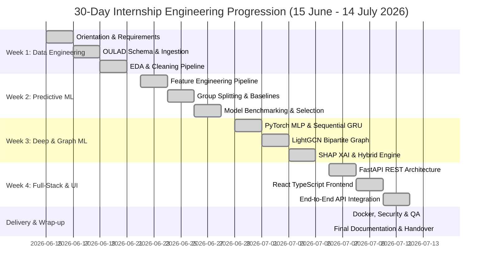

# 30-Day Project Timeline & Milestone Breakdown
## Adaptive Learning and Predictive Intelligence Platform
**Organization:** MintX Solutions  
**Role:** Machine Learning Intern  
**Internship Period:** 15 June 2026 – 14 July 2026 (30 Days)  
**Status:** Retrospective Engineering Reconstruction & Production Verification  

---

### Executive Milestone Schedule

| Phase | Calendar Window | Core Engineering Objectives | Deliverables & Milestone Output |
|---|---|---|---|
| **Phase 1: Problem Definition & Data Engineering** | 15 June – 21 June 2026 (Days 1–7) | Domain research, OULAD relational schema audit, data ingestion pipeline, missing value analysis, zero-leakage temporal boundary design. | Relational ingestion scripts (`scripts/ingest_data.py`), baseline validation schemas (`ml/data/validator.py`), EDA notebook (`notebooks/exploratory_data_analysis.ipynb`). |
| **Phase 2: Feature Engineering & Predictive Modeling** | 22 June – 28 June 2026 (Days 8–14) | Multimodal feature engineering (demographic, behavioral, assessment), student-grouped splitting (`GroupShuffleSplit`), supervised ML benchmark. | Feature extraction pipeline (`ml/features/feature_pipeline.py`), trained ML models (`artifacts/models/`), benchmark logs (`docs/EXPERIMENTS.md`). |
| **Phase 3: Deep Learning & Graph Recommendation** | 29 June – 5 July 2026 (Days 15–21) | PyTorch Tabular MLP, sequential clickstream Behavior GRU, LightGCN bipartite student-resource graph embeddings, SHAP TreeExplainer integration. | PyTorch checkpoints (`tabular_mlp.pt`, `behavior_gru.pt`), graph representations (`graph_embeddings.npz`), hybrid recommender (`ml/recommendation/hybrid_engine.py`). |
| **Phase 4: Full-Stack Integration & SaaS Dashboard** | 6 July – 12 July 2026 (Days 22–28) | FastAPI REST service (12 endpoints), JWT authentication, SQLAlchemy models, React 18 TypeScript Vite SPA, persona-based dashboards. | Integrated backend API (`backend/app/main.py`), production frontend build (`frontend/dist/`), end-to-end integration test suite (`backend/tests/`). |
| **Phase 5: Quality Assurance, Security & Delivery** | 13 July – 14 July 2026 (Days 29–30) | Comprehensive Pytest suite, Ruff linting, Gitleaks secret scanning, Docker Compose containerization, final documentation and handover. | Production Docker configuration, automated CI/CD workflows, final internship report (`docs/INTERNSHIP_FINAL_REPORT.md`), project delivery. |

---

### Weekly Milestone Progressions

