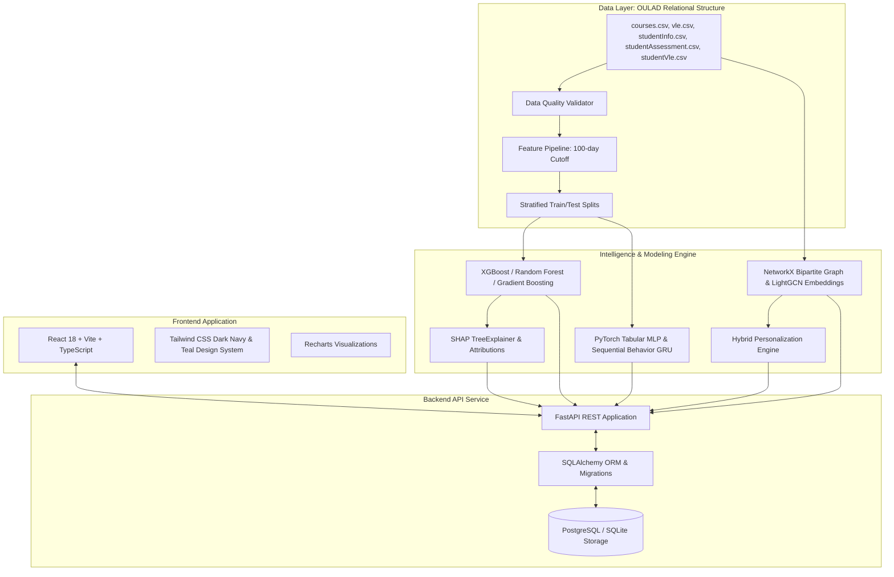

# System Architecture & Technical Design
## Adaptive Learning & Predictive Intelligence Platform

### 1. Architectural Overview
The platform adopts a decoupled, multi-tiered architecture that separates telemetry ingestion, predictive model execution, graph learning, and presentation layers.

### 2. Component Breakdown

#### 2.1 Feature Pipeline & Leakage Prevention
Feature engineering rigorously enforces an early warning cutoff day (day 100) on both VLE clicks and assessment submissions. This guarantees that model evaluation tests actual early predictive capability rather than end-of-term outcome correlation.

#### 2.2 Machine Learning Ensembles
- **Logistic Regression**: Scaled baseline model providing linear interpretability.
- **Random Forest**: 150-tree bagging ensemble robust to outliers and skewed distributions.
- **Gradient Boosting**: Sequential boosting model optimizing log-loss.
- **XGBoost**: Extreme Gradient Boosting with shrinkage and depth regularization.

#### 2.3 PyTorch Deep Learning
- **Tabular MLP**: Deep network with batch normalization, ReLU non-linearities, and dropout (0.3) for cross-feature interaction.
- **Behavior GRU**: 2-layer Recurrent Gated Unit ingesting 12-week time-series vectors to capture momentum and engagement decay.

#### 2.4 Bipartite Graph Learning & LightGCN
Constructs a heterogeneous bipartite graph $G = (V_S \cup V_R, E)$ with 4,006 nodes (3,500 students, 506 learning resources) and 80,696 interaction edges. Evaluates structural multi-hop neighborhood aggregation:
$$E^{(k+1)} = D^{-\frac{1}{2}} A D^{-\frac{1}{2}} E^{(k)}$$

#### 2.5 Explainable AI (SHAP)
Integrates TreeExplainer to compute exact Shapley values for XGBoost risk forecasts, providing students and educators with unambiguous factor attributions.
